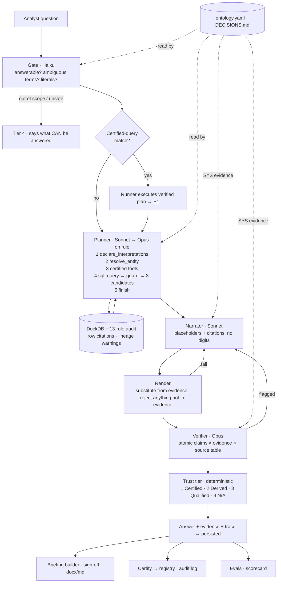

# Architecture (one page)

| Layer | Code | Tests |
|---|---|---|
| Data + audit | `backend/app/data/` | `tests/test_store_and_audit.py` |
| Certified tools, certified queries, SQL guard | `backend/app/tools/` | `tests/test_certified_queries.py`, `tests/test_entities_and_specs.py` |
| Agent (gate, planner, narrator, render, verifier, tier, SQL candidates, trace) | `backend/app/agent/` | `tests/test_evidence_render.py` |
| Model routing + provider (Anthropic / Bedrock) | `backend/app/llm/` | — |
| Certified registry, runs, analytics | `backend/app/registry/` | `tests/test_registry.py` |
| API, briefings, MCP | `backend/app/api.py`, `briefings.py`, `mcp_server.py` | `tests/test_api_and_mcp.py` |
| Frontend | `frontend/src/` | built in CI |
| Evals | `evals/` | run against the live model |

Design rationale: `AGENTIC_DESIGN.md`. Trust model: `TRUST_AND_HALLUCINATION.md`. Interpretive defaults: `../DECISIONS.md`.
